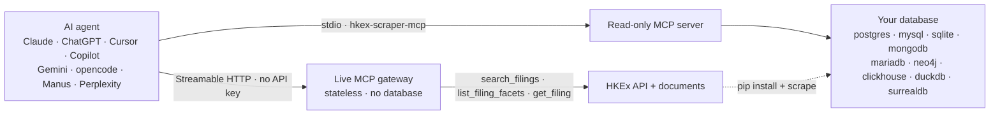

# Live MCP gateway

The **live MCP gateway** exposes HKEx filings to MCP clients over HTTP, fetching fresh data
from the HKEx website on every call. It is the hosted companion to the [MCP server](mcp.md):
where that server runs over stdio and reads a *stored* corpus from a database sink, this
gateway is **stateless**, stores nothing, and needs no database.

Endpoint:

```text
https://hkex-listco-updates.ascent-partners.com/api/mcp
```

The endpoint speaks **Streamable HTTP**: send `POST` requests carrying JSON-RPC 2.0. It is
not a web page — opening the URL in a browser sends `GET`, which the gateway answers with
`405 Method Not Allowed` (the MCP specification allows this when no server-sent-events
stream is offered). Cross-origin clients are supported through an `OPTIONS` CORS preflight
and an `Origin` allowlist.

## How it works

The gateway is the hosted, database-free half of the project. The [MCP server](mcp.md) is the
local half; the same client can use either.



If the diagram does not render, it is also available as
[an image](assets/mcp.png) — the tools and limits below are the full interface.

## Tools

| Tool | What it does |
| ---- | ------------ |
| `get_server_info` | Reports the gateway version, transport, and hard limits. Reads nothing. |
| `search_filings` | Searches live filings in a date window (at most 31 days), optionally narrowed by stock code, title, document type, category, or stock name. |
| `list_filing_facets` | Browses the categories, document types, and stock codes present in a date window, with counts — no document download. |
| `get_filing` | Downloads one HKEx document and extracts its text and tables. Long documents page with `offset`/`max_chars` (follow `next_offset`); `query` searches the whole document and returns matches with offsets. |

Every tool is **read-only**. The gateway never writes, never runs schema DDL, and never
fetches an arbitrary URL — `get_filing` accepts only HKEx document hosts.

### Search filters

`search_filings` narrows a window with five optional, combinable filters:

| Filter | Match | Example |
| ------ | ----- | ------- |
| `stock_code` | Exact stock code; leading zeros optional | `01461` or `1461` |
| `title_query` | Case-insensitive substring of the title | `dividend` |
| `document_type` | Exact file type | `PDF`, `HTML`, `XLSX` |
| `category` | Case-insensitive substring of the HKEx category | `share buyback` |
| `stock_name` | Case-insensitive substring of the stock short name | `hsbc` |

Filters combine with AND. They apply to the filings fetched for the window, so raise
`max_results` to catch rarer matches. Each returned filing carries the `fileType`, `sizeText`,
`category`, and `newsId` metadata alongside its date, stock code, stock name, title, and link.
Call `list_filing_facets` first to see which categories, document types, and stock codes a
window holds.

### Examples

Search a window for one company's filings whose title mentions dividends:

```bash
curl -sS https://hkex-listco-updates.ascent-partners.com/api/mcp \
  -H "content-type: application/json" \
  -d '{
    "jsonrpc": "2.0",
    "id": 1,
    "method": "tools/call",
    "params": {
      "name": "search_filings",
      "arguments": {
        "from_date": "2026-09-01",
        "to_date": "2026-09-30",
        "stock_code": "00700",
        "title_query": "dividend"
      }
    }
  }'
```

Browse what a window holds before drilling in — the categories, document types, and stock
codes with their counts:

```bash
curl -sS https://hkex-listco-updates.ascent-partners.com/api/mcp \
  -H "content-type: application/json" \
  -d '{
    "jsonrpc": "2.0",
    "id": 2,
    "method": "tools/call",
    "params": {
      "name": "list_filing_facets",
      "arguments": {"from_date": "2026-09-01", "to_date": "2026-09-30"}
    }
  }'
```

Pass a search result's `link` to `get_filing` to download and extract that document. For a long annual report, pass `query` (for example `"final dividend"`) to find the relevant passages, then read around a match with `offset` and `max_chars`.

## Limits

The model cannot raise these:

| Limit | Value |
| ----- | ----- |
| Search window | 31 days per call |
| `max_results` | 200 |
| Facet values | 50 per facet |
| Extracted text | 300,000 characters per document |
| Tables | 30 per document |

## Connecting a client

The gateway speaks **Streamable HTTP** (stateless, JSON responses) at `/api/mcp` and needs no
authentication. The full client list — Claude, ChatGPT, Cursor, Copilot, Gemini, opencode,
Manus, and Perplexity — is in [AI agent support](ai-agents.md).

**opencode** (`opencode.json`):

```json
{
  "$schema": "https://opencode.ai/config.json",
  "mcp": {
    "hkex-live": {
      "type": "remote",
      "url": "https://hkex-listco-updates.ascent-partners.com/api/mcp",
      "enabled": true
    }
  }
}
```

**Claude** — add it as a custom connector pointing at the endpoint URL, choosing
"no authentication".

**Cursor** (`~/.cursor/mcp.json`):

```json
{
  "mcpServers": {
      "hkex-live": {
        "url": "https://hkex-listco-updates.ascent-partners.com/api/mcp"
      }
  }
}
```

## Security

The gateway is a deliberately public, read-only API over public filings data. Its controls
are:

- **Read-only by construction** — four read tools; no write, SQL, or arbitrary-fetch surface.
- **SSRF allowlist** — documents are fetched only from HKEx hosts (`www1.hkexnews.hk`).
- **Origin validation** — requests carrying a disallowed `Origin` are rejected (MCP's
  DNS-rebinding mitigation).
- **No caching** — responses are sent with `Cache-Control: no-store`.
- **Rate limiting** — none at the edge. The Vercel Firewall rule (120 requests per 60 seconds per
  IP, `429` beyond) retired with the Vercel deployment in October 2026; the estate's ALB and WAF set
  no per-IP limit for this host, and WAF policy access is still an open item (apg-infra OI-29).
- **Liveness** — `GET /api/healthz` returns `{"ok":true}` and reads nothing.
- **Bounded responses** — the limits above keep every response well within the platform body
  limit.

## Deployment

The gateway ships as the **`hkex-mcp` container** — declared in `container.json`, built from
`docker/http.Dockerfile`, gunicorn on port **8041**. The transport is implemented directly in
`src/hkex_scraper/live_mcp.py` (it needs no server SDK and no ASGI lifespan), and `api/mcp.py`
mounts it.

Routing belongs to the balancer, not the node: the ALB sends `/api/*` on
`hkex-listco-updates.ascent-partners.com` to the hkex API group (container port 8041) and every
other path to the shared nginx origin on `:8088`, which serves this documentation site. The ALB
also terminates TLS, with the estate's wildcard certificate; no node runs a routing web server,
holds a certificate, or carries a per-host configuration file. Port, health and host-rule changes
are declared in the host file on ecs-04 and applied with `publish.py plan|apply` in a publishing
window (a **new** port also needs a security-group rule; both node groups are at the 20-rule limit
— apg-infra OI-25).

Historically the gateway was a single Python function on Vercel (region `hkg1`, Singapore
failover, Fluid compute), deployed from this repository alongside the documentation site, with
pushes to `main` deploying production and every other branch a preview. That path retired when the
gateway moved to the estate in October 2026; `vercel.json` survives as the historical hosting
contract — do not `vercel deploy`.

The document-extraction libraries (`PyMuPDF`, `pymupdf4llm`, `openpyxl`) are AGPL-3.0, so
they are not published dependencies of the distribution (see [Legal](legal.md)); a runtime that
needs extraction installs them through the `deploy` dependency group in `pyproject.toml`.
`pymupdf4llm` is pinned to a release that depends only on PyMuPDF — its 1.x line pulls an
additional layout model (onnxruntime and numpy) that no image here needs.

## See also

- [AI agent support](ai-agents.md) — configuration for Claude, ChatGPT, Cursor, Copilot, Gemini, opencode, Manus, and Perplexity.
- [MCP server](mcp.md) — the stdio server over a stored corpus.
- [Configuration](configuration.md) — environment variables for the CLI and sinks.
